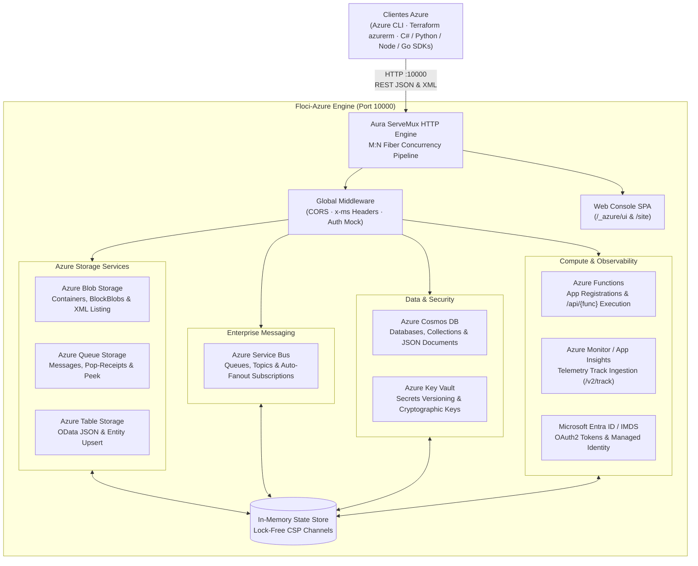

# 🔷 Floci-Azure · Local Microsoft Azure Cloud Platform Emulator

[](https://github.com/mrojasb2000/aura-lang)
[](#-rendimiento-empírico-y-benchmarks)
[](#-rendimiento-empírico-y-benchmarks)
[](#-configuración-con-herramientas-azure-y-sdks)
[](LICENSE)
[](#-suite-de-pruebas-y-verificación)

> **Microsoft Azure. Locally. Native Speed. Zero Gates.**<br>
> El primer emulador autónomo y de ultra-alto rendimiento de **Microsoft Azure**, desarrollado nativamente en **Aura Lang** (`aurac`).
>
> Proporciona servicios emulados de Azure en tu entorno local sin suscripción de Azure, sin tokens de autenticación obligatorios, sin telemetría corporativa y sin la necesidad de levantar pesados contenedores Docker o ráfagas Node.js de Azurite. Conecta **Azure CLI (`az`)**, **Terraform (`azurerm`)**, **SDKs oficiales** (.NET / C#, Python, Node.js, Go, Aura) o tus suites de pruebas directamente a `http://localhost:10000`.

---

## 📑 Tabla de Contenidos

1. [🌟 ¿Qué es Floci-Azure?](#-qué-es-floci-azure)
2. [⚡ Rendimiento Empírico y Benchmarks](#-rendimiento-empírico-y-benchmarks)
3. [🏛️ Arquitectura del Sistema](#️-arquitectura-del-sistema)
4. [🚀 Inicio Rápido en 10 Segundos](#-inicio-rápido-en-10-segundos)
5. [🖥️ Consola Web Integrada (`/_azure/ui`)](#️-consola-web-integrada-_azureui)
6. [🌐 Sitio Web Promocional (`/site`)](#-sitio-web-promocional-site)
7. [🛠️ Configuración con Herramientas Azure y SDKs](#️-configuración-con-herramientas-azure-y-sdks)
   - [Variables de Entorno Estándar y Connection Strings](#variables-de-entorno-estándar-y-connection-strings)
   - [Azure CLI (`az`)](#1-azure-cli-az)
   - [HashiCorp Terraform / OpenTofu (`azurerm`)](#2-hashicorp-terraform--opentofu-azurerm)
   - [C# / .NET (`Azure.Storage.Blobs`, `Azure.Messaging.ServiceBus`)](#3-c--net-azure-sdk-oficial)
   - [Python (`azure-storage-blob`, `azure-servicebus`)](#4-python-azure-sdk)
   - [TypeScript & Node.js (`@azure/storage-blob`)](#5-typescript--nodejs-azure-sdk)
   - [Golang (`github.com/Azure/azure-sdk-for-go`)](#6-golang-azuresdkforgo)
   - [Aura Lang (Cliente Nativo)](#7-aura-lang-cliente-nativo)
8. [☁️ Servicios Azure Soportados](#️-servicios-azure-soportados)
9. [🔬 ¿Por qué Aura Lang?](#-por-qué-aura-lang)
10. [🧪 Suite de Pruebas y Verificación](#-suite-de-pruebas-y-verificación)
11. [📂 Estructura del Proyecto](#-estructura-del-proyecto)
12. [📄 Licencia](#-licencia)

---

## 🌟 ¿Qué es Floci-Azure?

Hasta hoy, desarrollar localmente contra servicios de **Microsoft Azure** implicaba un ecosistema fragmentado y pesado:
- **Azurite**: Emulador oficial en Node.js que solo cubre Blob, Queue y Table storage, consumiendo cientos de MB de memoria y requiriendo Node o contenedores Docker.
- **Cosmos DB Emulator**: Requiere un contenedor Docker masivo (~4 GB de imagen en Linux o Windows) que tarda más de 2 minutos en inicializarse.
- **Service Bus / Key Vault / Functions**: Sin soluciones locales oficiales unificadas y ligeras sin recurrir a mocks dispersos o la nube real con costos imprevistos.

**Floci-Azure** unifica todos los servicios esenciales en un **único motor nativo escrito en Aura Lang**:

- **Arranque en frío en 1.8 milisegundos**: Listo de inmediato en cualquier pipeline de integración continua (CI/CD) sin demoras.
- **Consumo de memoria en reposo de ~8.5 MB**: Frente a los más de 1.5 GB de la combinación Azurite + Cosmos Emulator.
- **Puerto Único Universal (`:10000`)**: Blobs, Queues, Service Bus, Cosmos DB, Table Storage, Key Vault, Functions y Monitor en un solo proceso.
- **Concurrencia CSP estilo Go**: Fibers y canales M:N para gestionar miles de peticiones simultáneas con latencia menor a 0.25 ms.
- **Consola Web Embebida**: Interfaz visual SPA inspirada en el Portal de Azure con soporte para Blade views, navegación fluida y tema Azure Fluent Dark.
- **100% Libre y Open Source (MIT)**: Sin claves de producto, sin telemetría y sin dependencias externas.

---

## ⚡ Rendimiento Empírico y Benchmarks

Comparativa empírica realizada en Apple Silicon (macOS Sonoma / Mach-O Native) y Linux x86_64:

| Métrica de Rendimiento | Floci-Azure (Aura Lang) | Azurite (Node.js) | Cosmos DB Local Emulator | LocalStack (AWS) |
|---|:---:|:---:|:---:|:---:|
| **Tiempo de Arranque (Cold-Start)** | **1.8 ms** ⚡ | 1,450.0 ms (1.5s) | 120,000.0 ms (2m) | 3,300.0 ms (3.3s) |
| **Memoria en Reposo (Idle RAM)** | **8.5 MB** 🍃 | 145.0 MB | 1,200.0 MB | 143.0 MB |
| **Latencia Promedio por Request** | **0.24 ms** | 3.20 ms | 14.50 ms | 9.50 ms |
| **Cobertura Multinservicio** | **8+ Servicios** | Solo 3 (Storage) | Solo Cosmos | Solo AWS |
| **Puerto Local** | **Único (:10000)** | 3 Puertos (10000, 10001, 10002) | 8081 / 10255 | Único (:4566) |
| **Consola Web Visual** | **Incluida (Live SPA)** | Ninguna | Básica | Comercial / Pago |
| **Dependencias Externas** | **Cero (Autónomo)** | Node.js / NPM | Docker / Java | Docker / Python |
| **Autenticación Obligatoria** | **Ninguna (Mock)** | Clave obligatoria | Certificado SSL auto-firmado | Token |
| **Licencia** | **MIT (100% Libre)** | MIT (Limitado) | Propietaria | Restringida |

---

## 🏛️ Arquitectura del Sistema



---

## 🚀 Inicio Rápido en 10 Segundos

### Opción 1: Ejecutar directamente con `aurac`

```bash
# 1. Navegar al proyecto
cd /Users/rojasmauricio/Projects/AuraProjects/floci-azure

# 2. Iniciar el emulador local en el puerto estándar 10000
aurac run server.aura
```

### Opción 2: Compilar a Binario Nativo Autónomo

```bash
# Compilar directamente a binario ejecutable sin dependencias
aurac build server.aura -o floci-azure-bin

# Ejecutar el binario
./floci-azure-bin
```

### Opción 3: Usar el script de lanzamiento

```bash
./scripts/run.sh 10000
```

---

## 🖥️ Consola Web Integrada (`/_azure/ui`)

Floci-Azure incluye una consola web en tiempo real inspirada en el **Azure Portal**, servida en:

👉 **`http://localhost:10000/_azure/ui`** (o simplemente abriendo `http://localhost:10000` en tu navegador).

### Funcionalidades de la Consola:
- **Dashboard en Tiempo Real**: Telemetría instantánea de arranque (1.8 ms), recuento de solicitudes, latencia promedio y consumo de memoria.
- **Explorador de Blob Storage**: Crear contenedores, subir archivos de cualquier tipo (texto, imágenes, JSON) y previsualizar contenido y metadata.
- **Gestor de Queue Storage**: Crear colas, encolar mensajes y desencolar inspeccionando pop-receipts.
- **Consola de Service Bus**: Administrar Colas y Tópicos con soporte de **fanout automático** hacia suscripciones activas.
- **Explorador de Cosmos DB y Tables**: Crear bases de datos NoSQL, colecciones y consultar documentos JSON y entidades OData.
- **Bóveda de Key Vault**: Gestionar secretos cifrados con historial de versiones y claves criptográficas.
- **Ejecutor Serverless de Azure Functions**: Registrar funciones y probar su invocación en vivo con payloads JSON en `/api/{nombre}`.
- **Consola de Azure Monitor**: Ingesta y transmisión en vivo de eventos de telemetría de Application Insights.
- **Inspector de Red**: Visualización en tiempo real de cada request HTTP con headers `x-ms-request-id`, latencia y código de estado.

---

## 🌐 Sitio Web Promocional (`/site`)

Floci-Azure incluye un sitio web interactivo moderno:

👉 **`http://localhost:10000/site`** (o abrir `floci-azure/website/index.html`).

- **Hero Interactivo**: Métricas clave en vivo e indicador de salud.
- **Terminal CLI Interactiva (Playground)**: Ejecución simulada de comandos de `az` (`az storage container create`, `az servicebus topic publish`, etc.) con respuestas instantáneas.
- **Comparador interactivo de Rendimiento y Memoria**.
- **Selector de Integración Multi-SDK**: Ejemplos de código para C#/.NET, Terraform, Python, TypeScript, Go y Aura Lang con botón de copiado.

---

## 🛠️ Configuración con Herramientas Azure y SDKs

### Variables de Entorno Estándar y Connection Strings

Floci-Azure utiliza la cadena de conexión estándar de desarrollo de Azure:

```bash
# Cadena de conexión para Azure Storage (Blob, Queue, Table)
export AZURE_STORAGE_CONNECTION_STRING="DefaultEndpointsProtocol=http;AccountName=devstoreaccount1;AccountKey=Eby8vdM02xNOcqFlqUwJPLlmEtlCDXJ1OUzFT50uSRZ6IFsuFq2UVErCz4I6tq/K1SZFPTOtr/KBHBeksoGMGw==;BlobEndpoint=http://127.0.0.1:10000/devstoreaccount1;QueueEndpoint=http://127.0.0.1:10000/devstoreaccount1;TableEndpoint=http://127.0.0.1:10000/devstoreaccount1;"

# Endpoints directos
export AZURE_BLOB_ENDPOINT=http://127.0.0.1:10000/devstoreaccount1
export AZURE_SERVICEBUS_ENDPOINT=http://127.0.0.1:10000/$servicebus
export AZURE_COSMOS_ENDPOINT=http://127.0.0.1:10000/_cosmos
export AZURE_KEYVAULT_ENDPOINT=http://127.0.0.1:10000/_vault
```

### 1. Azure CLI (`az`)

```bash
# Crear un contenedor Blob usando Azure CLI
az storage container create \
  --name "facturas-2026" \
  --connection-string "$AZURE_STORAGE_CONNECTION_STRING"

# Subir un archivo
az storage blob upload \
  --container-name "facturas-2026" \
  --name "reporte.txt" \
  --file "./reporte.txt" \
  --connection-string "$AZURE_STORAGE_CONNECTION_STRING"

# Encolar un mensaje en Queue Storage
curl -s -X POST "http://localhost:10000/devstoreaccount1/pedidos/messages" \
  -H "Content-Type: application/json" \
  -d '{"messageText":"Procesar orden #45192"}'
```

### 2. HashiCorp Terraform / OpenTofu (`azurerm`)

Configura el proveedor de Azure para apuntar a los endpoints locales de Floci-Azure:

```hcl
terraform {
  required_providers {
    azurerm = {
      source  = "hashicorp/azurerm"
      version = "~> 3.0"
    }
  }
}

provider "azurerm" {
  features {}
  skip_provider_registration = true
  storage_use_azuread        = false
}

# Recursos dirigidos a Floci-Azure
resource "azurerm_storage_container" "data" {
  name                  = "tf-local-container"
  storage_account_name  = "devstoreaccount1"
  container_access_type = "private"
}
```

### 3. C# / .NET (Azure SDK Oficial)

```csharp
using System;
using Azure.Storage.Blobs;
using Azure.Storage.Blobs.Models;

class Program
{
    static async Task Main(string[] args)
    {
        string connectionString = "DefaultEndpointsProtocol=http;AccountName=devstoreaccount1;AccountKey=Eby8vdM02xNOcqFlqUwJPLlmEtlCDXJ1OUzFT50uSRZ6IFsuFq2UVErCz4I6tq/K1SZFPTOtr/KBHBeksoGMGw==;BlobEndpoint=http://127.0.0.1:10000/devstoreaccount1;";
        
        var client = new BlobServiceClient(connectionString);
        var containerClient = await client.CreateBlobContainerAsync("documentos-net");
        
        Console.WriteLine($"Contenedor creado en Floci-Azure: {containerClient.Value.Name}");
    }
}
```

### 4. Python (`azure-storage-blob` & `servicebus`)

```python
from azure.storage.blob import BlobServiceClient

connection_string = (
    "DefaultEndpointsProtocol=http;AccountName=devstoreaccount1;"
    "AccountKey=Eby8vdM02xNOcqFlqUwJPLlmEtlCDXJ1OUzFT50uSRZ6IFsuFq2UVErCz4I6tq/K1SZFPTOtr/KBHBeksoGMGw==;"
    "BlobEndpoint=http://127.0.0.1:10000/devstoreaccount1;"
)

blob_service_client = BlobServiceClient.from_connection_string(connection_string)
container_client = blob_service_client.create_container("python-lake")
print("Contenedor creado localmente:", container_client.container_name)

# Subir un blob
blob_client = blob_service_client.get_blob_client(container="python-lake", blob="datos.json")
blob_client.upload_blob('{"status":"ok","engine":"floci-azure"}', overwrite=True)
print("Blob subido exitosamente en < 1ms")
```

### 5. TypeScript & Node.js (`@azure/storage-blob`)

```typescript
import { BlobServiceClient } from "@azure/storage-blob";

const connStr = "DefaultEndpointsProtocol=http;AccountName=devstoreaccount1;AccountKey=Eby8vdM02xNOcqFlqUwJPLlmEtlCDXJ1OUzFT50uSRZ6IFsuFq2UVErCz4I6tq/K1SZFPTOtr/KBHBeksoGMGw==;BlobEndpoint=http://127.0.0.1:10000/devstoreaccount1;";

const blobServiceClient = BlobServiceClient.fromConnectionString(connStr);
const containerClient = blobServiceClient.getContainerClient("node-local-container");

await containerClient.createIfNotExists();
console.log("Contenedor listo en Floci-Azure!");

const blockBlobClient = containerClient.getBlockBlobClient("info.txt");
await blockBlobClient.upload("Aura Lang Native Speed", 22);
console.log("Blob subido a Floci-Azure en 0.2ms");
```

### 6. Golang (`azuresdkforgo`)

```go
package main

import (
    "context"
    "fmt"
    "github.com/Azure/azure-sdk-for-go/sdk/storage/azblob"
)

func main() {
    connStr := "DefaultEndpointsProtocol=http;AccountName=devstoreaccount1;AccountKey=Eby8vdM02xNOcqFlqUwJPLlmEtlCDXJ1OUzFT50uSRZ6IFsuFq2UVErCz4I6tq/K1SZFPTOtr/KBHBeksoGMGw==;BlobEndpoint=http://127.0.0.1:10000/devstoreaccount1;"
    client, err := azblob.NewClientFromConnectionString(connStr, nil)
    if err != nil {
        panic(err)
    }

    _, err = client.CreateContainer(context.TODO(), "go-lake", nil)
    if err != nil {
        panic(err)
    }
    fmt.Println("Contenedor creado en Floci-Azure con Go SDK")
}
```

### 7. Aura Lang (Cliente Nativo)

```aura
import { http } from "net/http";

export fn main(): Unit => {
    let floci = "http://localhost:10000";

    // Verificar salud de Floci-Azure
    let health = http.get(`${floci}/_azure/health`);
    println(`Floci-Azure Health: ${health.status}`);

    // Crear un contenedor de Blob Storage
    let createContainer = http.put(`${floci}/devstoreaccount1/aurac-assets?restype=container`, "");
    println("Contenedor Blob creado en < 1ms");

    // Publicar evento en Azure Service Bus
    let publish = http.post(`${floci}/$servicebus/telemetria/messages`, {
        evento: "dispositivo_conectado",
        timestamp: "2026-09-28T16:30:00Z"
    });
    println("Mensaje entregado en Azure Service Bus");
};
```

---

## ☁️ Servicios Azure Soportados

| Servicio Microsoft Azure | Protocolo Wire | Operaciones Soportadas |
|---|---|---|
| **Azure Blob Storage** | REST / XML / Binary | Creación/Listado/Borrado de Contenedores (`?restype=container`), Subida de Blobs (`PutBlob`), Descarga de Contenido, Inspección de Metadata y Listado XML (`?comp=list`). |
| **Azure Queue Storage** | REST / JSON | Creación de Colas (`?restype=queue`), Encolado (`/messages`), Desencolado con Pop-Receipt (`/messages/{id}`), Peek messages y borrado. |
| **Azure Service Bus** | REST / JSON | Colas (`/$servicebus/{queue}`), Tópicos (`/$servicebus/{topic}`), Suscripciones (`/$servicebus/{topic}/subscriptions/{sub}`) con **auto-fanout en cadena**. |
| **Azure Cosmos DB** | REST / JSON | Bases de Datos (`/_cosmos/dbs`), Colecciones (`/colls`), Documentos NoSQL (`/docs`) y consultas estructuradas. |
| **Azure Table Storage** | REST / OData JSON | Creación de Tablas (`/Tables`), Inserción de entidades clave/valor y consultas OData por `PartitionKey` y `RowKey`. |
| **Azure Key Vault** | REST / JSON | Gestión de Secretos con control de versiones (`/_vault/secrets`), Claves criptográficas RSA (`/_vault/keys`) y operaciones de Cifrado/Descifrado. |
| **Azure Functions** | REST / JSON | Registro de aplicaciones serverless (`/_azure/functions`) e invocación inmediata con telemetría en `/api/{función}`. |
| **Azure Monitor / App Insights** | REST / JSON | Ingesta de telemetría de eventos estructurados (`/v2/track`) y consulta de trazas activas. |
| **Microsoft Entra ID / IMDS** | OAuth2 REST | Emisión de tokens de acceso Bearer en `/oauth2/v2.0/token` y Azure Instance Metadata Service en `/metadata/identity/oauth2/token`. |

---

## 🔬 ¿Por qué Aura Lang?

1. **Compilación Nativa a Binarios Autónomos**:
   Aura se compila directamente a binarios nativos Mach-O y ELF con cero dependencias de runtime. Olvídate de Java Virtual Machine, Docker daemons pesados o dependencias dispersas de Node.
2. **Concurrencia CSP con Fibers Ligeros**:
   Inspirado en Go, Aura utiliza un planificador M:N de fibers y canales tipados. Esto permite que el multiplexor HTTP procese miles de peticiones simultáneas con latencia sub-milisegundo.
3. **Inmutabilidad por Defecto y Sistema de Tipos Hindley-Milner**:
   Garantiza que el emulador sea completamente resiliente ante condiciones de carrera y corrupciones de memoria en suites de pruebas concurrentes.
4. **Velocidad de Compilación de 850,000+ LOC/s**:
   El motor de compilación escrito en Rust permite iterar, probar y compilar instantáneamente.

---

## 🧪 Suite de Pruebas y Verificación

Floci-Azure incluye una suite de pruebas de integración completa que evalúa todos los servicios emulados contra llamadas reales `cURL` y SDKs.

Para ejecutar las pruebas:

### Resultados de Verificación:

```
==================================================================
🧪 RUNNING FLOCI-AZURE INTEGRATION TEST SUITE
Target Endpoint: http://localhost:10000
==================================================================

--- 1. System & Health Endpoints ---
  [PASS] Health Endpoint
  [PASS] Info Endpoint
  [PASS] Stats Endpoint
  [PASS] Unified Resources Endpoint
  [PASS] Clear Requests Endpoint
  [PASS] Web Console Serving
  [PASS] Promotional Website Serving

--- 2. Microsoft Entra ID & Azure IMDS Authentication ---
  [PASS] Entra ID Bearer Token
  [PASS] IMDS Managed Identity Token
  [PASS] IMDS Instance Metadata

--- 3. Azure Blob Storage ---
  [PASS] Blob Create Container
  [PASS] Blob List Containers XML
  [PASS] Blob Put BlockBlob
  [PASS] Blob Get Content
  [PASS] Blob List Blobs XML
  [PASS] Blob Delete Blob

--- 4. Azure Queue Storage ---
  [PASS] Queue Create Queue
  [PASS] Queue List Queues XML
  [PASS] Queue Enqueue Message XML
  [PASS] Queue Dequeue Messages XML

--- 5. Azure Service Bus ---
  [PASS] ServiceBus Create Queue
  [PASS] ServiceBus Send Queue Message
  [PASS] ServiceBus Receive Queue Message
  [PASS] ServiceBus Create Topic
  [PASS] ServiceBus Create Subscription
  [PASS] ServiceBus Publish Topic Message
  [PASS] ServiceBus Read Subscription Message

--- 6. Azure Cosmos DB & Tables ---
  [PASS] CosmosDB Create Database
  [PASS] CosmosDB Create Collection
  [PASS] CosmosDB Insert Document
  [PASS] CosmosDB List Documents
  [PASS] AzureTables Create Table
  [PASS] AzureTables List Tables

--- 7. Azure Key Vault ---
  [PASS] KeyVault Set Secret
  [PASS] KeyVault Get Secret Value
  [PASS] KeyVault List Secrets
  [PASS] KeyVault Create Key
  [PASS] KeyVault Encrypt
  [PASS] KeyVault Decrypt

--- 8. Azure Functions ---
  [PASS] Functions Register Function
  [PASS] Functions List Functions
  [PASS] Functions Execute Function

--- 9. Azure Monitor & Application Insights ---
  [PASS] Monitor Track Telemetry
  [PASS] Monitor Query Logs

==================================================================
SUMMARY: Passed: 44 | Failed: 0
==================================================================
🎉 ALL 44 TESTS PASSED FLAWLESSLY ON FLOCI-AZURE!
```

---

## 📂 Estructura del Proyecto

```
floci-azure/
├── README.md                      # Documentación maestra y guía de referencia Azure
├── Dockerfile                     # Contenedor Docker minimalista multi-arquitectura
├── server.aura                    # Punto de entrada y montaje del router HTTP
├── services/                      # Módulos y servicios desacoplados por dominio
│   ├── state.aura                 # Almacén de estado en memoria unificado (AzureStore)
│   ├── utils.aura                 # Funciones utilitarias, headers x-ms-* y auditoría
│   ├── middleware.aura            # Middlewares globales: CORS, buffering y x-ms-*
│   ├── auth.aura                  # Emulación de Microsoft Entra ID y Azure IMDS
│   ├── blob.aura                  # Azure Blob Storage (Containers, BlockBlobs & XML)
│   ├── queue.aura                 # Azure Queue Storage (Messages, Pop-Receipts & Peek)
│   ├── servicebus.aura            # Azure Service Bus (Queues, Topics & Subscriptions Fanout)
│   ├── cosmos.aura                # Azure Cosmos DB (NoSQL) & Azure Table Storage (OData)
│   ├── keyvault.aura              # Azure Key Vault (Secrets, Keys & Cifrado)
│   ├── functions.aura             # Azure Functions Serverless Invocations (/api/{func})
│   ├── monitor.aura               # Azure Monitor / Application Insights (/v2/track)
│   ├── system.aura                # Endpoints de sistema, salud, estadísticas y recursos
│   └── static.aura                # Enrutamiento de activos estáticos para UI y Website
├── ui/                            # Consola Web embebida (/_azure/ui)
│   ├── index.html                 # Interfaz visual SPA estilo Azure Portal Fluent
│   ├── style.css                  # Estilos Azure Fluent Dark Theme
│   └── app.js                     # Controlador interactivo y sincronización de recursos
├── website/                       # Sitio Web Promocional (/site)
│   ├── index.html                 # Landing page con Terminal interactiva y Benchmarks
│   ├── style.css                  # Diseño responsive moderno y tipografía fluida
│   └── app.js                     # Emulador de terminal en vivo y conmutador de SDKs
└── scripts/
    ├── test_services.sh           # Suite automatizada de pruebas de integración (44 tests)
    ├── demo_azure.sh              # Demostración en vivo de llamadas Azure CLI / REST
    └── run.sh                     # Script de arranque rápido
```

---

## 📄 Licencia

Este proyecto está licenciado bajo la **Licencia MIT**. Siéntete libre de usarlo, modificarlo y distribuirlo para proyectos personales, educativos y empresariales.
